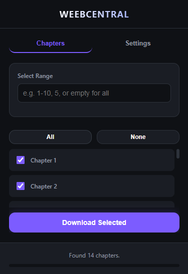

<div align="center">

# 📚 WeebCentral Downloader

### *Download manga chapters from weebcentral.com with ease*

[](https://www.google.com/chrome/)
[](https://www.microsoft.com/edge)
[](LICENSE)

---



</div>

## ✨ Features

| Feature | Description |
|---------|-------------|
| 🖼️ **Multiple Download Formats** | Download as individual images, ZIP archives, or PDF documents |
| 📑 **Batch Chapter Download** | Select and download multiple chapters at once |
| 🎯 **Chapter Range Selection** | Use ranges like `1-10, 15, 20-25` to quickly select chapters |
| ⚡ **Quick Download Button** | Green download button on chapter pages for instant downloads |
| ⚙️ **Customizable Settings** | Adjust download delay and concurrent download limits |
| 📊 **Real-time Progress** | Track download progress with status updates |

---

## 🔗 Alternative: Python Script

> **Prefer a standalone solution?** Check out the [WeebCentral Downloader Script](https://github.com/Yui007/weebcentral_downloader) - a fast Python-based alternative!

---

## 🚀 Installation

### Manual Installation (Developer Mode)

1. **Clone or download** this repository
   ```bash
   git clone https://github.com/Yui007/weebcentral_extension.git
   ```

2. **Open your browser's extension page**
   - Chrome: `chrome://extensions/`
   - Edge: `edge://extensions/`

3. **Enable Developer Mode** (toggle in top-right corner)

4. **Click "Load unpacked"** and select the extension folder

5. **Done!** The extension icon will appear in your toolbar

---

## 📖 How to Use

### Quick Download (Single Chapter)

1. Navigate to any **chapter page** on weebcentral.com
2. Click the **green "Download Chapter"** button in the top-right corner
3. Images will download in your selected format (set in Settings)

### Batch Download (Multiple Chapters)

1. Navigate to a **manga series page** on weebcentral.com
2. Click the **extension icon** in your browser toolbar
3. Chapters will be fetched automatically
4. **Select chapters** using:
   - Checkboxes for individual selection
   - Range input (e.g., `1-10, 15, 20-25`)
   - "All" or "None" buttons
5. Click **"Download Selected"**

### Download Formats

Configure your preferred format in the **Settings** tab:

| Format | Output |
|--------|--------|
| **Images** | Individual `.jpg` files organized in folders |
| **ZIP** | One `.zip` archive per chapter |
| **PDF** | One `.pdf` document per chapter |

---

## ⚙️ Settings

| Setting | Description | Default |
|---------|-------------|---------|
| **Download Format** | Images, ZIP, or PDF | Images |
| **Download Delay** | Milliseconds between downloads | 300ms |
| **Image Concurrency** | Simultaneous image downloads | 3 |
| **Chapter Concurrency** | Simultaneous chapter processing | 1 |

---

## 🔧 Troubleshooting

<details>
<summary><b>❌ No images found</b></summary>

- Scroll through the chapter page to ensure all images are loaded
- Refresh the page and try again
- Check if the site is loading images from a different domain

</details>

<details>
<summary><b>❌ Download fails or incomplete</b></summary>

- Increase the **Download Delay** in Settings
- Reduce **Image Concurrency** to 1 or 2
- Check your internet connection

</details>

<details>
<summary><b>❌ Chapters not loading</b></summary>

- Make sure you're on a **manga series page**, not a chapter page
- The URL should look like: `weebcentral.com/series/...`

</details>

<details>
<summary><b>❌ PDF generation fails</b></summary>

- PDF generation opens a background tab - allow popups if blocked
- Large chapters may take longer to process

</details>

---

## 📁 Project Structure

```
weebcentral_extension/
├── 📄 manifest.json        # Extension configuration
├── 📄 popup.html           # Extension popup UI
├── 📄 popup.js             # Popup initialization
├── 📄 logic.js             # Core popup logic
├── 📄 ui.js                # UI management
├── 📄 settings.js          # Settings management
├── 📄 content.js           # Content script (green button)
├── 📄 background.js        # Background service worker
├── 📄 manga-scraper.js     # Manga scraping & downloading
├── 📄 pdf-generator.html   # PDF generation page
├── 📄 pdf-generator.js     # PDF generation logic
├── 📄 jszip.min.js         # ZIP creation library
├── 📄 jspdf.min.js         # PDF creation library
├── 📄 styles.css           # Popup styles
└── 📁 icons/               # Extension icons
```

---

## 🔒 Privacy

This extension:
- ✅ Does **NOT** collect any personal data
- ✅ Does **NOT** track your browsing history  
- ✅ Processes everything **locally** on your device
- ✅ Only requests **necessary** permissions

---

## 📜 License

This project is licensed under the **MIT License** - see the [LICENSE](LICENSE) file for details.

---

## 🙏 Acknowledgments

- [JSZip](https://stuk.github.io/jszip/) - ZIP file creation
- [jsPDF](https://github.com/parallax/jsPDF) - PDF document generation

---

<div align="center">

*This extension is not affiliated with or endorsed by weebcentral.com*

**Made with ❤️ by manga fans, for manga fans**

</div>
